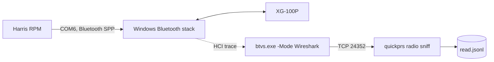
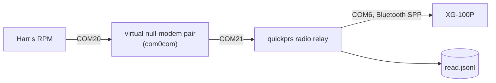
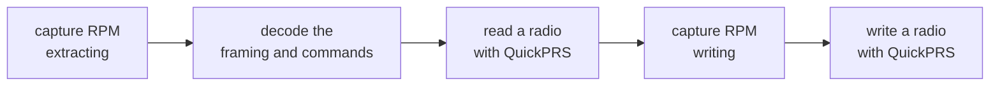

# Talking to the radio over Bluetooth

QuickPRS cannot read or program a radio by itself yet. The `quickprs radio`
commands are the groundwork: they find the radio, listen to it, and record
what RPM and the radio say to each other, so the programming protocol can be
learned from real sessions instead of guessed.

**None of these commands sends a byte of its own to the radio.** The relay
forwards only what RPM sends.

## Bluetooth Classic, not BLE

The XG-100P's Bluetooth is Bluetooth Classic with the Serial Port Profile
(SPP). Windows gives a paired radio an outgoing COM port, and RPM's help
("Setting Up A Bluetooth Connection") describes programming the radio over
that port just as over the USB cable: extract (read), write, activate and
remove mission plans.

## Setup

1. Install pyserial (the standalone EXE already includes it):
   ```bash
   pip install pyserial
   ```
2. Pair the radio. On the radio: SETTINGS > BLUETOOTH, set ENABLED to YES,
   then PAIRING MGNT > ADD NEW and pick the PC; accept the pass key on both.
   Bluetooth must be enabled in the radio's personality
   (Options > Bluetooth Settings).
3. Find its COM port:
   ```bash
   quickprs radio scan          # --ble also lists nearby BLE devices (needs bleak)
   ```

## Listen

```bash
quickprs radio probe --port COM6 --seconds 15 --log first.jsonl
```

Opens the port and prints anything the radio sends. A radio that is off,
out of range or not paired shows up here as a connection timeout.

## Record an RPM session

RPM does the talking; QuickPRS only records it. There are two ways.

### From a Bluetooth trace (no driver)

Microsoft's Bluetooth Virtual Sniffer (BTVS, in the free Bluetooth Test
Platform package from Microsoft) records the packets Windows exchanges with
its Bluetooth controller, using Windows' own tracing, and serves them on TCP
for Wireshark. `quickprs radio sniff` reads that stream and keeps only the
serial bytes RPM and the radio exchange. RPM uses the radio's COM port as
usual, and nothing is installed in it or between it and the radio.



1. Install the Bluetooth Test Platform (an MSI from Microsoft; needs admin).
2. In an administrator console, from the package's BTVS folder:
   ```bash
   btvs.exe -Mode Wireshark
   ```
   Click **Full Packet Logging** in its window: without it, large data
   packets are left out of the trace. Wireshark does not need to be
   installed.
3. Start recording:
   ```bash
   quickprs radio sniff --log read.jsonl --note "RPM extract"
   ```
4. Turn the radio on, and in RPM extract it over its Bluetooth COM port.
5. Press Ctrl+C in QuickPRS, then close BTVS.

A full trace holds more than the serial data (Bluetooth link keys among
it); QuickPRS writes only the serial bytes, and only from the radio's link
once the trace has shown which link that is. `--pcap trace.pcapng` reads a
trace saved from Wireshark instead.

### Through a virtual null-modem pair

A virtual null-modem pair such as com0com (free, open source) links two COM
ports, for example COM20 and COM21. RPM opens one end, the relay opens the
other and the radio's port, and every byte is passed across and logged:



```bash
quickprs radio relay --pc-port COM21 --radio-port COM6 --log read.jsonl --note "RPM extract"
```

Then point RPM's connection at COM20 and extract the radio's personality as
usual. The relay also copies RPM's DTR/RTS lines to the radio's port.

com0com's signed x64 driver cannot load while Windows 11's Memory Integrity
(Core isolation) is on: its INIT section is writable and executable, which
Memory Integrity refuses. Use the Bluetooth trace instead of turning
Memory Integrity off.

## Look at a capture

```bash
quickprs radio analyze read.jsonl
quickprs radio analyze read.jsonl --extract radio.PRS
```

`analyze` counts bytes in each direction, lists readable strings and the
MFC class names it finds, and `--extract` writes out a personality found in
the radio's replies. Protocol bytes after the personality can end up in that
file, so treat it as something to compare with the .PRS RPM saved for the
same session, not as a finished file.

A capture is a JSON Lines file: a header line, then one line per chunk read
(`t` seconds since the start, `dir` `pc>radio` or `radio>pc`, `hex` bytes)
and modem-line events.

## Next steps



Writing comes last and only after reading works and the write session is
understood byte for byte: a bad write can leave a radio unusable.
