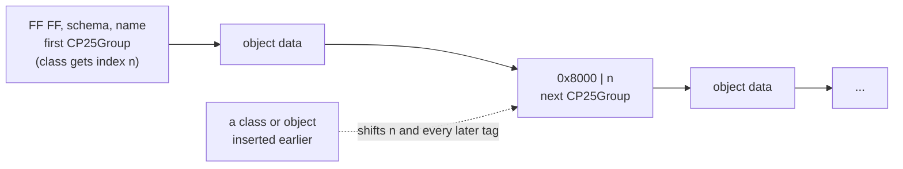
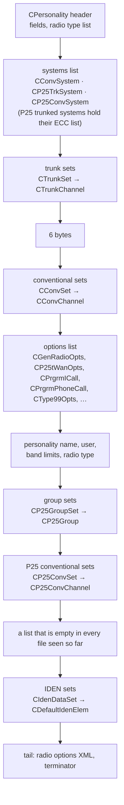
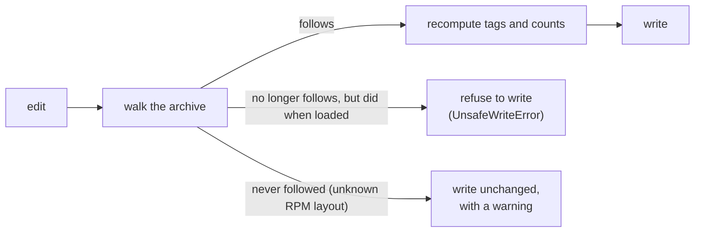

# The .PRS file format

A .PRS personality is the saved state of RPM's document, written with
Microsoft MFC's `CArchive` serialization (RPM's `persdata.dll` links
`mfc100.dll`). QuickPRS reads a file into a tree that keeps every byte
(`quickprs/archive.py`), edits the tree, and writes it back with the
archive's bookkeeping recomputed, so edits keep the structure RPM reads.

## Two rules every edit has to keep

**Class and object numbering.** The archive numbers every class and every
object as it writes them, starting at 1 (0 is the null object). The first
object of a class is written as `FF FF`, the class schema (2 bytes), the
name length (2 bytes) and the name. Every later object of that class is the
2-byte tag `0x8000 | class index`.

**List counts.** A list is a 2-byte count followed by its objects.

So adding one talkgroup changes the index of every class first written
after it, and with it every later tag, and the count in front of its list.
RPM's loader (`CArchive::ReadObject`) rejects a tag that does not name the
class it expects (`badIndex`, `badClass`) and a class written with another
schema (`badSchema`).



QuickPRS 1.0.x copied these tags from the source file, which is right only
while nothing in front of them changes. Since 1.1 it rebuilds them on every
save.

## Document order

RPM writes the parts of a personality in this order:



Trunk channels are stored as RPM shows them: transmit is the site's uplink
(806 MHz on an 800 MHz system) and receive the downlink (851 MHz).

## What happens on save



`quickprs repair` rewrites the stale tags and counts in a file saved by
QuickPRS 1.0.x.

## Not yet confirmed

These fields are read and written as they are, but their meaning has not
been checked against RPM:

- **IDEN elements:** QuickPRS reads the first two fields (4 bytes, then 2)
  as channel spacing and bandwidth. One RPM-saved table has an element with
  base 851.00625 MHz holding 12500 in the first and 6250 in the second; that
  base reaches the system's channels (851.0125 MHz and up) only in 6.25 kHz
  steps, so the two may be the other way round. One RPM save with a single
  IDEN value changed would settle it.
- **Enhanced control channel (ECC) entries:** four numbers per entry; how
  they map to RFSS, site and channel has not been confirmed.
- **Analog channel fields RPM always sets:** every analog channel RPM
  creates, with or without tones, holds 85 in both 2-byte fields after the
  tone strings (QuickPRS calls them `tx_addr` and `rx_addr`) and 1 in flag
  byte 22 (`tone_mode`). QuickPRS 1.2 and later write the same in new
  channels; earlier versions wrote 0, 0 and 0, and what difference that
  makes on the radio is not known.

### How to settle them in RPM

Each check is: save a file, change one thing, save a copy, and let
`quickprs compare` name the field that moved. Work on a copy of a
personality, never on the one in a radio.

```bash
quickprs compare before.PRS after.PRS
```

1. **IDEN spacing and bandwidth.** Open a personality with an IDEN set
   and save it as `iden-a.PRS`. Change only the channel spacing of one
   element (12.5 to 6.25 kHz, say), save as `iden-b.PRS`. Put it back,
   change only that element's bandwidth, save as `iden-c.PRS`. Comparing
   a with b, then a with c, shows which field each setting is.
2. **ECC entries.** Save a personality whose P25 system has enhanced
   control channel entries as `ecc-a.PRS`. Change one number in one entry
   (its RFSS, its site, or its channel, one at a time), saving after each
   as `ecc-b.PRS`, `ecc-c.PRS` and so on.
3. **The analog channel fields.** Add a conventional channel in RPM with
   no tones and save as `ch-a.PRS`. Give it a CTCSS tone, save as
   `ch-b.PRS`; switch the tone to DCS, save as `ch-c.PRS`. If RPM shows a
   squelch or signalling type for the channel, change it on its own too.
   A field that stays at 85 through all of these is a constant; one that
   moves shows what it follows.

Send the saved files, or the `compare` output, and the field names in
QuickPRS get fixed to match.
