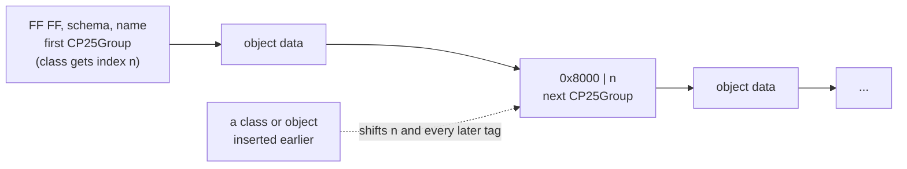
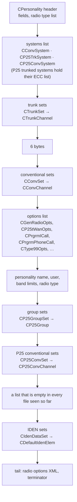
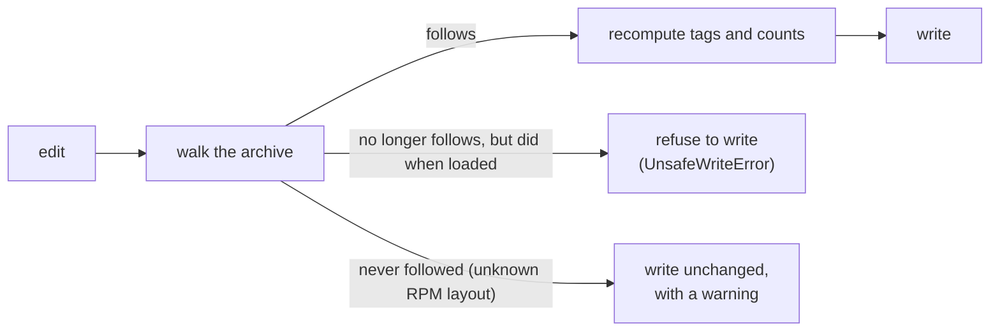

# The .PRS file format

A .PRS personality is the saved state of RPM's document, written with
Microsoft MFC's `CArchive` serialization (RPM's `persdata.dll` links
`mfc100.dll`). QuickPRS reads a file into a tree that keeps every byte
(`quickprs/archive.py`), edits the tree, and writes it back with the
archive's bookkeeping recomputed, so edits keep the structure RPM reads.

## Two rules every edit has to keep

**Class and object numbering.** The archive numbers every class and every
object as it writes them, starting at 1 (0 is the null object). The first
object of a class is written as `FF FF`, the class schema (2 bytes), the
name length (2 bytes) and the name. Every later object of that class is the
2-byte tag `0x8000 | class index`.

**List counts.** A list is a 2-byte count followed by its objects.

So adding one talkgroup changes the index of every class first written
after it, and with it every later tag, and the count in front of its list.
RPM's loader (`CArchive::ReadObject`) rejects a tag that does not name the
class it expects (`badIndex`, `badClass`) and a class written with another
schema (`badSchema`).

QuickPRS 1.0.x copied these tags from the source file, which is right only
while nothing in front of them changes. Since 1.1 it rebuilds them on every
save.

## Document order

RPM writes the parts of a personality in this order:

Trunk channels are stored as RPM shows them: transmit is the site's uplink
(806 MHz on an 800 MHz system) and receive the downlink (851 MHz).

## What happens on save

`quickprs repair` rewrites the stale tags and counts in a file saved by
QuickPRS 1.0.x.

## Not yet confirmed

These fields are read and written as they are, but their meaning has not
been checked against RPM:

- **IDEN elements:** QuickPRS reads the first two fields (4 bytes, then 2)
  as channel spacing and bandwidth. One RPM-saved table has an element with
  base 851.00625 MHz holding 12500 in the first and 6250 in the second; that
  base reaches the system's channels (851.0125 MHz and up) only in 6.25 kHz
  steps, so the two may be the other way round. One RPM save with a single
  IDEN value changed would settle it.
- **Enhanced control channel (ECC) entries:** four numbers per entry; how
  they map to RFSS, site and channel has not been confirmed.

A good way to settle either: change one value in RPM, save, and compare the
two files with `quickprs compare --detail` or `quickprs dump`.
